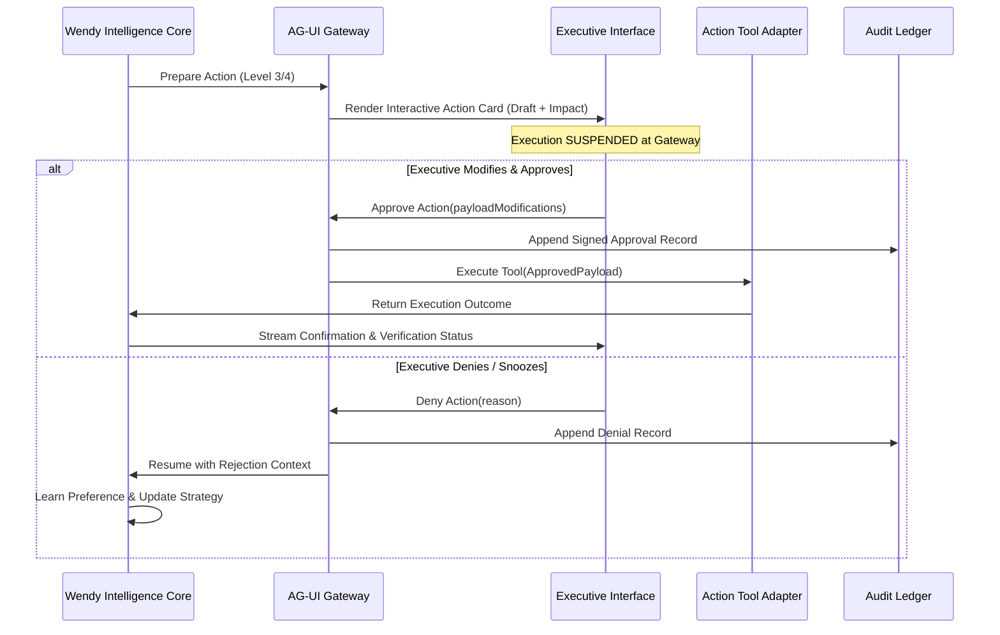

# WENDY — AUTHORIZATION MODEL & GOVERNANCE FRAMEWORK
**Version:** 1.0.0  
**Classification:** Security, Governance & Human-in-the-Loop Protocol  

---

## 1. Governance Principles

Wendy is engineered for high-consequence executive environments. Autonomous intelligence without deterministically bounded execution is a liability. 

1. **Principle of Explicit Staging:** External actions are never triggered as blind side-effects. They are first **staged** as concrete proposals with simulated consequences.
2. **Deterministic Authorization Gate:** The capability to propose an action is strictly decoupled from the authority to execute it.
3. **Auditability & Provenance:** Every executed action contains an immutable cryptographic trail linking back to the human authorization event, the prompt/event trigger, and the evidence cited.

---

## 2. The 5-Tier Authorization Matrix

| Level | Classification | Approval Requirement | Allowed Autonomy | Typical Operations |
| :--- | :--- | :--- | :--- | :--- |
| **Level 0** | **Observe** | None | Full Autonomy | Reading calendar, inspecting permitted emails, querying contacts, indexing documents, searching external web. |
| **Level 1** | **Prepare** | None (Zero Side Effects) | Full Autonomy | Compiling meeting dossiers, drafting email responses, formulating proposed calendar shifts, drafting task items. |
| **Level 2** | **Internal Action** | Configurable (Default: Autonomous) | Configurable Policy | Updating Wendy's memory graph, categorizing internal notes, tagging contacts, marking internal tasks complete. |
| **Level 3** | **External Action** | **Mandatory Approval by Default** | Strict Human-in-the-Loop | Sending emails, sending SMS/WhatsApp, inviting external parties to calendar events, moving scheduled meetings. |
| **Level 4** | **High-Impact Action**| **Always Explicit Multi-Factor Approval** | Never Autonomous | Approving contracts, wire transfers/financial authorizations, broad stakeholder announcements, irreversible deletions. |

---

## 3. Human-in-the-Loop (HITL) Protocol via AG-UI

When Wendy decides that an action is required to resolve an anticipated need, she initiates the **AG-UI Suspension Cycle**:



---

## 4. Action Staging Envelope & UI Surface Contract

Every staged action presented to the executive must provide the following standard schema to the AG-UI layer:

```typescript
export interface StagedActionEnvelope {
  actionId: string;
  authorizationLevel: 0 | 1 | 2 | 3 | 4;
  category: 'EMAIL_DISPATCH' | 'CALENDAR_MUTATION' | 'EXTERNAL_MESSAGE' | 'CONTRACT_SIGN';
  targetEntity: {
    name: string;
    role: string;
    relationshipTier: number;
  };
  summaryHeadline: string; // e.g. "Send birthday message to Carlos (Tier 1)"
  evidenceJustification: string[]; // e.g. ["Sent personal note last year", "Recent close partner"]
  preview: {
    recipient: string;
    subject?: string;
    bodyText: string;
    scheduledDispatchTime?: string;
  };
  consequencesAnalysis: {
    reversibility: 'IRREVERSIBLE' | 'REVERSIBLE_WITH_EFFORT' | 'FULLY_REVERSIBLE';
    impactSummary: string;
    contingencyPlan?: string;
  };
  actionsAvailable: Array<'APPROVE' | 'EDIT_BEFORE_SEND' | 'SNOOZE' | 'REJECT'>;
}
```

---

## 5. Rollback, Failure Recovery & Post-Execution Verification

1. **Scheduled Grace Windows:** For Level 3 email dispatches, Wendy supports a configurable 60-second undo buffer before actual transmission.
2. **Automated Verification:**
   - Immediately following dispatch, a verification worker confirms the downstream API response code.
   - For emails, an asynchronous thread listener watches for immediate bounce notices or automated out-of-office autoreplies.
   - For calendar shifts, a webhook watches for invitee rejection or conflict flags.
3. **Escalation on Verification Failure:** If an executed action fails verification, Wendy immediately escalates:
   > *"The calendar invitation to Carlos failed because of a conflicting permissions restriction on his corporate tenant. I have reverted your local calendar block and staged a direct email notification instead."*
