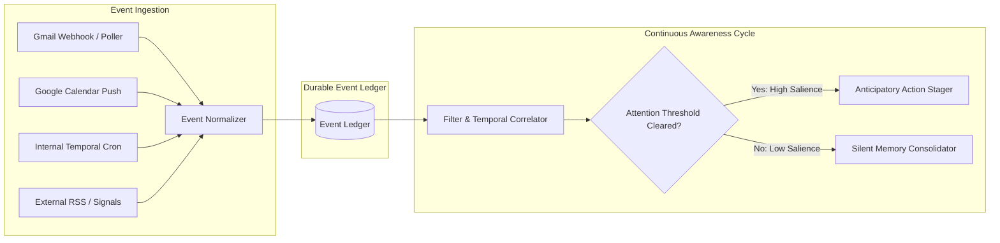

# WENDY — EVENT-DRIVEN ARCHITECTURE & EVENT MODEL
**Version:** 1.0.0  
**Classification:** Reactive Sensory & Awareness Specification  

---

## 1. Event Architecture Overview

Wendy does not wait for user keystrokes. She is an event-driven system anchored by an append-only **Reactive Event Ledger**. External sensors (Calendar, Email, Contacts, Documents) and internal scheduled triggers publish standardized events into the bus, activating the **Continuous Awareness Engine**.



---

## 2. Standardized Event Envelope

Every event in Wendy implements the strict `WendyEventEnvelope` specification:

```typescript
export interface WendyEventEnvelope<T = Record<string, any>> {
  eventId: string; // UUID v4
  correlationId: string; // Distributed tracing ID linking related events
  causationId?: string; // ID of the event that caused this event
  eventType: WendyEventType;
  timestamp: string; // ISO 8601 UTC
  actor: {
    id: string;
    type: 'EXECUTIVE' | 'EXTERNAL_CONTACT' | 'SYSTEM_AGENT' | 'SYSTEM_CRON';
    identifier: string; // e.g., email or handle
  };
  primaryEntity: {
    entityType: 'Person' | 'CalendarEvent' | 'Email' | 'Commitment' | 'Document' | 'Project';
    entityId: string;
  };
  secondaryEntityIds?: string[];
  importanceScore: number; // 0.0 to 1.0
  confidenceScore: number; // 0.0 to 1.0
  epistemicCategory: 'FACT' | 'INFERENCE' | 'HYPOTHESIS';
  provenance: {
    sourceSystem: 'GOOGLE_WORKSPACE' | 'MICROSOFT_GRAPH' | 'SLACK' | 'INTERNAL_TICK';
    rawPayloadHash: string;
    externalId?: string;
  };
  permissions: {
    accessScope: 'EXECUTIVE_PRIVATE' | 'RESTRICTED_TEAM' | 'PUBLIC';
    retentionPolicyDays: number;
  };
  payload: T;
}
```

---

## 3. Core Event Catalog

### 3.1 Communication Events
- **`EMAIL_RECEIVED`:** Fired upon receipt of incoming message. Triggers intent analysis, commitment scanning, and urgency evaluation.
- **`EMAIL_SENT`:** Fired when the executive (or Wendy on approval) sends an email. Triggers commitment extraction (promises made by executive) and updates relationship cadence.
- **`THREAD_RESOLVED`:** Fired when a protracted thread concludes or agreements are finalized.

### 3.2 Calendar & Meeting Lifecycle
- **`CALENDAR_CREATED`:** New event scheduled. Triggers attendee profiling and strategic importance classification.
- **`CALENDAR_CHANGED`:** Event time, location, or attendees modified. Triggers conflict checking and travel buffer re-computation.
- **`CALENDAR_CANCELLED`:** Event removed. Updates pending briefings and releases focus blocks.
- **`MEETING_APPROACHING_T30`:** Fired exactly 30 minutes before start. Synthesizes and delivers the 3-point briefing dossier.
- **`MEETING_STARTED`:** Meeting starts. Switches context state to "In Meeting".
- **`MEETING_COMPLETED`:** Triggers prompt for voice memo/notes, commitment harvesting, and action item follow-up.

### 3.3 Relationship & Person Events
- **`PERSON_MILESTONE_APPROACHING`:** Birthday, work anniversary, or key date detected within $T-48$ hours. Triggers thoughtful message drafting.
- **`RELATIONSHIP_CADENCE_LAPSED`:** Tier 1 contact exceeds expected contact frequency (e.g., 90 days without touch). Triggers subtle reconnection proposal.
- **`RELATIONSHIP_SENTIMENT_SHIFTED`:** Sudden tone shift detected in correspondence. Triggers relationship risk assessment.

### 3.4 Commitments & Governance
- **`COMMITMENT_CREATED`:** Explicit or implicit promise detected in email or transcript.
- **`COMMITMENT_APPROACHING_DEADLINE`:** 24h before promised deliverable. Checks whether deliverable exists in drafts or sent files.
- **`COMMITMENT_OVERDUE`:** Promised deadline elapsed without fulfillment. Generates urgent escalation to executive.
- **`ACTION_APPROVAL_REQUESTED`:** Action staged by Wendy, requiring executive Level 3/4 confirmation.
- **`ACTION_EXECUTED`:** External mutation completed. Spawns verification job.
- **`ACTION_VERIFIED`:** Delivery verified; outcomes recorded into episodic memory.

### 3.5 System & Intelligence Cycle
- **`SCHEDULED_INTELLIGENCE_RUN`:** Periodic heartbeat (e.g., 07:00 AM daily, 18:30 PM daily, hourly tick). Triggers the Morning/Evening Briefing compilation and unattended backlog review.
- **`EXTERNAL_SIGNAL_DETECTED`:** Market, competitor, or corporate announcements affecting portfolio or partners.

---

## 4. The Continuous Awareness Loop & Attention Filtering

The Continuous Awareness loop executes every time an event enters the bus:

```
                  ┌──────────────────────┐
                  │ Inbound Wendy Event  │
                  └──────────┬───────────┘
                             │
                             ▼
                  ┌──────────────────────┐
                  │ Entity Correlator    │
                  │ (Fetch Person/Graph) │
                  └──────────┬───────────┘
                             │
                             ▼
                  ┌──────────────────────┐
                  │ Salience Calculator  │
                  └──────────┬───────────┘
                             │
                 ┌───────────┴───────────┐
                 │                       │
      Score >= Threshold      Score < Threshold
                 │                       │
                 ▼                       ▼
      ┌─────────────────────┐ ┌─────────────────────┐
      │ Immediate Proactive │ │ Silent Background   │
      │ Preparation & Alert │ │ Memory Consolidation│
      └─────────────────────┘ └─────────────────────┘
```

### Dynamic Attention Formula
The system prevents notification fatigue using:

$$\text{Salience} = \frac{w_1 \cdot \text{Impact} + w_2 \cdot \text{Urgency} + w_3 \cdot \text{Tier} + w_4 \cdot \text{Confidence}}{1 + \text{InterruptionFatiguePenalty}}$$

- If $\text{Salience} \ge 0.85$: Immediate Proactive Presentation (Surface in AG-UI Urgent Rail).
- If $0.50 \le \text{Salience} < 0.85$: Staged for the next scheduled briefing window (Morning/Evening).
- If $\text{Salience} < 0.50$: Silently recorded into memory graph for reference without interruption.
