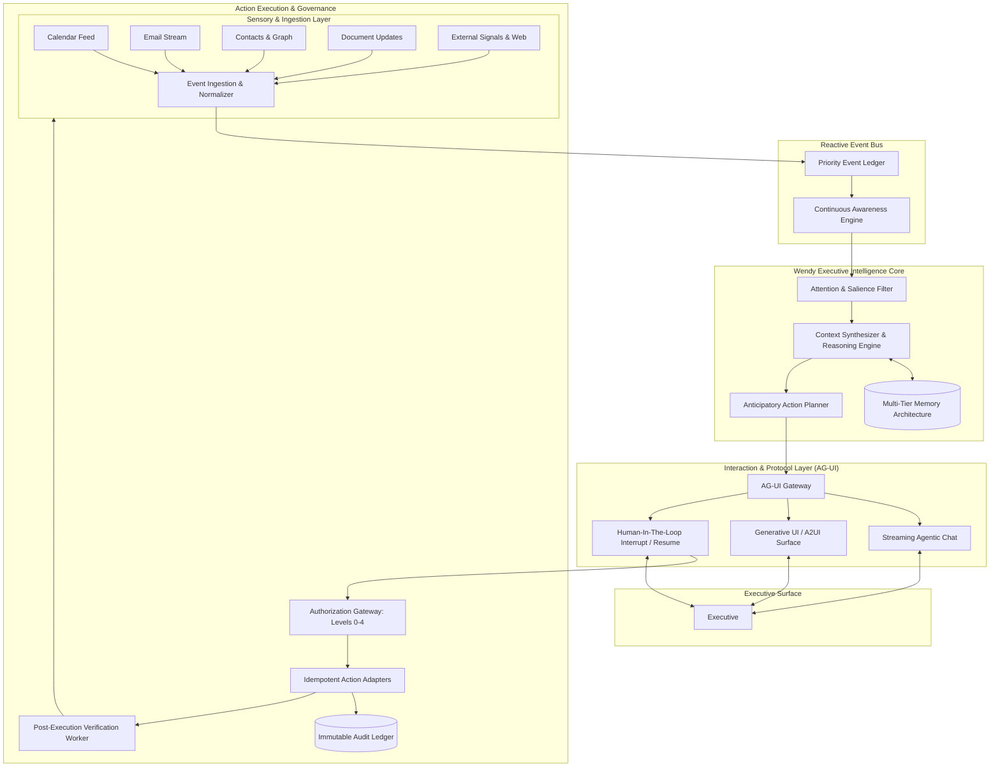

# WENDY — MASTER ARCHITECTURE SPECIFICATION
**Version:** 1.0.0-PROPOSAL  
**Classification:** Core System Architecture  
**Execution Environment:** Google Antigravity 2.0 / AG-UI  

---

## 1. Architectural Philosophy

Wendy's system architecture decouples **Presence**, **Protocol**, **Cognition**, **Memory**, and **Action**. Rather than a monolithic LLM wrapper, Wendy is designed as a continuous cybernetic loop with an event-driven sensory system and deterministic execution boundaries.

---

## 2. Core Subsystems & Components

### 2.1 Presence & Experience Layer (Executive Surface)
The interface is designed according to the **Wendy UX System**: restrained, editorial, cinematic, high-density, and calm.
- **Morning/Evening Briefing Canvas:** Dynamic briefing view containing high-salience items, pending approvals, and scheduled focus blocks.
- **Ambient Intelligence Stream:** Real-time feed of silent inferences, approaching deadlines, and pre-computed preparation packets.
- **Interactive Action Staging Drawer:** Where Level 3/4 actions (e.g., drafts to key partners, calendar shifts) are reviewed, modified, and authorized.
- **AG-UI Agentic Presence:** A responsive conversational surface that renders tool states, thoughts, live cards, and interactive widgets natively without jarring popups or technical jargon.

### 2.2 AG-UI Protocol & Gateway Layer
Wendy uses **AG-UI** as the formal interaction specification:
- **Agentic Chat:** Bi-directional streaming of natural language alongside structured tool execution envelopes.
- **Backend Tool Rendering:** Exposing tools gracefully (e.g., `"Reviewing correspondence with Carlos over the last 90 days"` instead of raw SQL or function signatures).
- **Human-In-The-Loop (HITL) Interrupts:** When an action requires Level 3/4 confirmation, Wendy suspends execution at the tool boundary, rendering an interactive approval widget. Upon executive sign-off, execution resumes seamlessly.
- **Shared State Sync:** Deep two-way synchronization between client UI widgets (e.g., editable email draft, calendar slider) and Wendy's working context.
- **A2UI (Agent-to-UI):** Dynamic UI schema rendering with resilient fallback and recovery mechanisms for cards, comparisons, and decision trees.

### 2.3 Wendy Executive Intelligence Core (Cognition)
The cognitive core operates on dual temporal loops:
1. **Background Continuous Awareness Loop (Tick / Event Driven):**
   - Wakes up on event receipt or temporal triggers (e.g., $T-60$ min before meeting).
   - Ingests new signals, evaluates importance, updates relationship health, detects unfulfilled promises.
   - Evaluates whether salience exceeds the **Attention Threshold**. If not, silently commits to memory without alerting.
2. **Foreground Interactive Cognitive Loop:**
   - Engages when the executive opens the application or directly queries Wendy.
   - Formulates proactive briefings, reasons across multi-hop entity relationships, and projects future implications.

### 2.4 Multi-Tier Memory Subsystem
Memory is structured into five distinct persistence strata (detailed in `WENDY_MEMORY_MODEL.md`):
1. **Working Working Context (RAM/Session):** Active thread context and immediate operational state.
2. **Episodic Store (Interactions & Events):** Chronological log of emails, meetings, calls, and observations with provenance IDs.
3. **Semantic Knowledge Graph:** Entity-Relationship network connecting People, Roles, Organizations, Projects, and Commitments.
4. **Relationship Dynamics:** Tracking interaction velocity, trust trajectory, reciprocity index, and sentimental shifts.
5. **Executive Preference & Heuristics Store:** Learned patterns of communication tone, delegation thresholds, and recurring scheduling rules.

### 2.5 Action Execution & Governance Gateway
Every execution is governed by the **Wendy Authorization Model**:
- **Strict Isolation:** Reading external data (Level 0) never triggers writing side effects (Level 3/4).
- **Idempotency Token:** Every external API call (Google Calendar insert, SendGrid/Gmail dispatch) is signed with an idempotency key to prevent double execution.
- **Verification Loop:** Every dispatched action spawns an asynchronous verification job (e.g., check that the recipient SMTP server accepted the email, monitor calendar invitations for RSVP changes).

---

## 3. Technology Stack Specification

| Tier | Recommended Technologies | Rationale |
| :--- | :--- | :--- |
| **Language & Runtime** | TypeScript 5.x / Node.js 22+ / Bun | Type-safety, JSON schema interoperability, native event loop, fast startup. |
| **UI Framework** | Next.js (App Router) / React 19 / Tailwind CSS | Editorial typography, SSR/streaming, rich interaction controls. |
| **Agentic Protocol** | AG-UI Core Protocol & CopilotKit SDK | Native support for streaming, frontend tool calls, A2UI, and HITL interrupts. |
| **Development & Agent Hosting** | Google Antigravity 2.0 SDK / Python / Node | Deep agent orchestration, MCP sidecars, background workers, scheduled jobs. |
| **Primary Database & Graph** | PostgreSQL + `pgvector` or Embedded SQLite + VectorLite | Relational integrity for domain ontology + vector similarity for associative recall. |
| **Event Bus & Queuing** | Redis Streams or Embedded SQLite Event Queue | Durable event logging, pub/sub for sensor feeds, zero data loss on restarts. |
| **LLM Inference** | Gemini 1.5 Pro / Flash (via Antigravity / Vertex AI) | 2M+ token context window for deep document retrieval, multi-modal reasoning, structured outputs. |

---

## 4. Security, Confidentiality & Compliance

1. **Zero Silent Writes:** Wendy cannot invoke external mutation tools without traversing the Authorization Gateway.
2. **Cryptographic Provenance:** Every memory entry and drafted action links back to raw immutable message hashes and calendar UID references.
3. **Local-First Boundary Options:** Sensitive company data, contact indexes, and memory stores can reside on dedicated enterprise VPCs or local secure enclaves, using Gemini API via VPC-SC.
4. **Comprehensive Audit Trail:** Every thought step, recommendation, executive approval, and downstream tool execution is permanently appended to a tamper-evident audit ledger.
