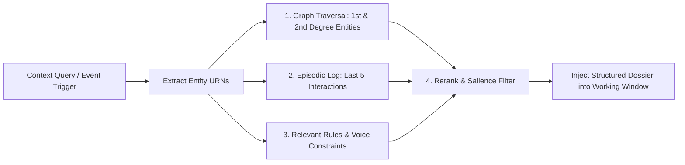

# WENDY — MULTI-TIER MEMORY MODEL & RETRIEVAL ARCHITECTURE
**Version:** 1.0.0  
**Classification:** Long-Term Cognitive Persistence & Retrieval Specification  

---

## 1. Memory Architectural Tenets

Wendy’s intelligence depends entirely on persistent, cross-session continuity. A system that suffers amnesia when restarted is incapable of anticipatory thinking.

1. **Model & Agent Agnostic:** Memories exist independently of LLM weights, agent sessions, or prompt structures. Models can be upgraded or swapped without degrading memory fidelity.
2. **Selective Association over Brute-Force Dumping:** Wendy never stuffs full historical transcripts into prompt context. She traverses relational nodes and retrieves only what is salient to the immediate context.
3. **No Hallucinated Memories:** Every persistent memory record must include an immutable provenance anchor (source system, message hash, timestamp, and derivation chain).

---

## 2. The 6-Strata Memory Hierarchy

```
┌─────────────────────────────────────────────────────────────┐
│ 1. Working Working Context (Active Token Window)            │
│    Immediate prompt messages, active tool calls, local scratch│
└──────────────────────────────┬──────────────────────────────┘
                               ▼
┌─────────────────────────────────────────────────────────────┐
│ 2. Session State (Thread Persistence)                       │
│    Ephemeral conversation intent, open drafts, active filters│
└──────────────────────────────┬──────────────────────────────┘
                               ▼
┌─────────────────────────────────────────────────────────────┐
│ 3. Episodic Memory (Interactions & Events Store)            │
│    Chronological immutable log: meetings, emails, decisions │
└──────────────────────────────┬──────────────────────────────┘
                               ▼
┌─────────────────────────────────────────────────────────────┐
│ 4. Relationship Trajectory & Semantic Graph                 │
│    Nodes: People, Orgs, Commitments; Edges: Dynamics, Trust │
└──────────────────────────────┬──────────────────────────────┘
                               ▼
┌─────────────────────────────────────────────────────────────┐
│ 5. Executive Preferences & Heuristics Store                 │
│    Learned drafting voice, scheduling constraints, thresholds│
└──────────────────────────────┬──────────────────────────────┘
                               ▼
┌─────────────────────────────────────────────────────────────┐
│ 6. Historical Outcomes & Continuous Feedback Store          │
│    Effectiveness records: what recommendations succeeded     │
└─────────────────────────────────────────────────────────────┘
```

---

## 3. Detailed Strata Specifications

### Stratum 1: Working Working Context
- **Scope:** In-flight LLM context window (Gemini 1.5/2.0 token budget).
- **Function:** Holds the immediate prompt, active system guidelines, focused entity cards, and live tool schemas.
- **Eviction:** Cleared when the current interaction turn concludes.

### Stratum 2: Session State
- **Scope:** Active user session (persisted in client local storage / Redis session).
- **Function:** Tracks current UI view, staged action envelopes awaiting approval, and active conversation thread IDs.

### Stratum 3: Episodic Memory
- **Scope:** Durable append-only relational store.
- **Schema:**
  ```typescript
  export interface EpisodicMemoryEntry {
    id: string;
    occurredAt: string;
    entityIds: string[];
    interactionType: 'EMAIL' | 'MEETING' | 'DECISION' | 'COMMITMENT_RESOLVED';
    summary: string;
    verbatimSnippet?: string;
    provenanceHash: string;
    sourceUri: string;
  }
  ```
- **Function:** Answers questions like: *"When did I last speak to Carlos?"* and *"What did we agree on regarding pricing?"*

### Stratum 4: Relationship Trajectory & Semantic Graph
- **Scope:** Relational graph database with vector indexing.
- **Attributes per Node/Edge:**
  - `reciprocityIndex`: Net favor balance.
  - `velocity`: Frequency of engagement over 30/60/90 days.
  - `sentimentTrend`: Moving average of correspondence tone.
  - `cadenceTargetDays`: Ideal frequency of interaction before drift alert.
- **Function:** Powers anticipatory triggers: *"Mariana's contact velocity dropped 70% over the last 60 days."*

### Stratum 5: Executive Preferences & Heuristics
- **Scope:** High-confidence rule and preference registry.
- **Rules Structure:**
  - Hard Constraints: *"Never schedule meetings on Friday afternoons after 14:00."*
  - Drafting Voice: *"Never use generic corporate greetings like 'Hope this email finds you well'. Be direct, warm, and concise."*
  - Relationship Heuristics: *"Always send personal notes for Tier 1 birthdays."*

### Stratum 6: Historical Outcomes & Reinforcement
- **Scope:** Evaluation and feedback ledger.
- **Function:** Records how the executive reacted to Wendy's past suggestions:
  - Did the executive accept the draft without edits?
  - Did the executive reject a meeting rescheduling?
  - Did Carlos accept the proposal sent using Wendy's framing?
- **Continuous Learning:** Informs future prompt weighting and attention scoring without retraining model weights.

---

## 4. Context Retrieval Pipeline

When Wendy prepares an answer or an anticipatory briefing, she executes a 4-stage retrieval pipeline:



### Retrieval Budget Constraint
To prevent context clutter and hallucination:
- Maximum 5 relevant entities.
- Maximum 3 recent episodic interactions.
- Hard constraint: Always display the **Provenance Footnote** for every extracted assertion.
