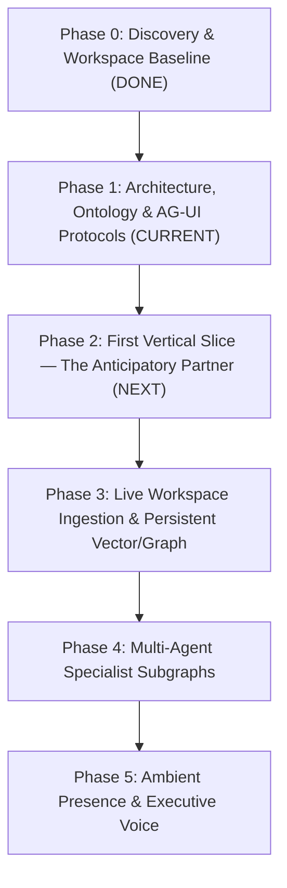

# WENDY — STRATEGIC IMPLEMENTATION ROADMAP
**Execution Framework:** Phased Vertical Slices  
**Current Phase:** Phase 0 & Phase 1 Execution  

---

## 1. Roadmap Architecture

Building an executive intelligence cannot be accomplished through superficial mockups or scattered features. Wendy will be implemented in rigorous, validated vertical slices, ensuring that each phase delivers an end-to-end cybernetic loop before expanding surface area.

---

## 2. Phase Breakdown & Deliverables

### Phase 0: Discovery & Workspace Baseline (COMPLETED)
- **Objective:** Evaluate local environment, runtime toolchains, and existing architecture.
- **Key Findings:**
  - Clean scratch environment initialized at `/Users/joaormendes/.gemini/antigravity/scratch/wendy`.
  - Node.js v26.9.0 and Python 3.14.7 available in runtime.
  - AG-UI interactive patterns analyzed via Dojo specification.
- **Artifacts:**
  - Workspace directory initialized.

### Phase 1: Product Architecture & System Specification (CURRENT)
- **Objective:** Define the complete domain model, event schemas, authorization boundaries, memory tiers, UX system, and Antigravity 2.0 alignment.
- **Key Deliverables:**
  - `WENDY_MASTER_ARCHITECTURE.md`
  - `WENDY_PRODUCT_PRINCIPLES.md`
  - `WENDY_CAPABILITY_MAP.md`
  - `WENDY_DOMAIN_MODEL.md`
  - `WENDY_EVENT_MODEL.md`
  - `WENDY_AUTHORIZATION_MODEL.md`
  - `WENDY_MEMORY_MODEL.md`
  - `WENDY_UX_SYSTEM.md`
  - `WENDY_ROADMAP.md`
  - Master Visual Architecture Artifact (`wendy_architecture_overview.md` / Generative UI Artifact).

### Phase 2: First Vertical Slice — The Anticipatory Partner (NEXT)
- **Objective:** Build ONE complete, uncompromised end-to-end proactive loop demonstrating the "First Wow Moment":
  1. **Event Ingestion:** Simulated event stream containing (a) upcoming meeting with Carlos, (b) Mariana's approaching birthday, (c) pending commitment to João, and (d) low-salience noise.
  2. **Context Retrieval:** Relational knowledge graph fetch linking past correspondence, tone preferences, and relationship tiers.
  3. **Wendy Reasoning:** Cognitive evaluation sorting items into Urgent, Relationship, Commitment, and "Can Wait".
  4. **Proactive Insight Delivery:** Streaming briefing presented over AG-UI protocol.
  5. **Human Authorization (HITL):** Interactive approval cards for the email draft to Mariana and pre-meeting briefing for Carlos.
  6. **Action & Verification:** Action dispatch to simulated external tool, cryptographic audit record, and confirmation loop.
  7. **Persistent Memory Update:** Outcomes, sent messages, and cadence updates committed to durable memory.
- **Validation Criteria:** A user sitting in front of Wendy experiences an autonomous, proactive briefing that solves problems before being asked, with zero manual prompting required.

### Phase 3: Live Workspace Ingestion & Persistent Storage
- **Objective:** Replace simulated adapters with real Google Workspace / Microsoft Graph OAuth connectors and durable database infrastructure.
- **Deliverables:**
  - Google Calendar & Gmail OAuth2 service with webhook sync.
  - PostgreSQL / SQLite database with `pgvector` / vector embeddings for multi-hop memory retrieval.
  - Background event daemon running continuous awareness checks.
  - Immutable cryptographic audit log for all Level 3/4 dispatches.

### Phase 4: Multi-Agent Specialist Subgraphs
- **Objective:** Decompose deep domain processing into specialized subagents while preserving a unified, single-presence Wendy interface.
- **Specialist Subgraphs:**
  - *Calendar Specialist:* Continuous schedule defragmentation and travel buffer guard.
  - *Relationship Specialist:* Reciprocity index calculation and cadence drift monitoring.
  - *Email & Commitment Specialist:* Deep thread archaeology and unfulfilled promise detection.
  - *Research Specialist:* External web intelligence on meeting attendees and corporate counterparties.
- **Orchestration:** Wendy Core acts as the central executive orchestrator, ensuring the user only ever interacts with one unified intelligence.

### Phase 5: Ambient Presence & Executive Voice
- **Objective:** Layer on subtle, non-intrusive sensory presence.
- **Deliverables:**
  - Low-latency bi-directional voice interface (using Gemini Live API / WebRTC).
  - Calm, editorial presence visualizer (micro-animations reflecting cognitive state: listening, synthesizing, standing by).
  - Executive mobile companion surface for on-the-go authorization.

---

## 3. Immediate Next Steps

Upon review and alignment on this architectural foundation:
1. Initialize the TypeScript / Next.js / AG-UI project structure in `/Users/joaormendes/.gemini/antigravity/scratch/wendy`.
2. Implement the Domain Model and In-Memory Graph Store.
3. Build the AG-UI protocol integration and the three-zone Executive Workspace surface.
4. Execute the Phase 2 Vertical Slice demonstrating the complete anticipation-to-verification loop.
